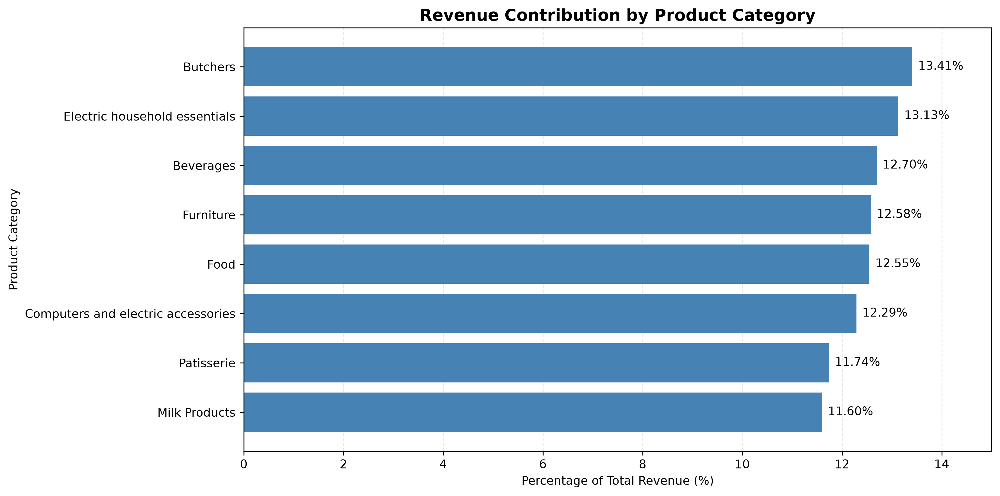
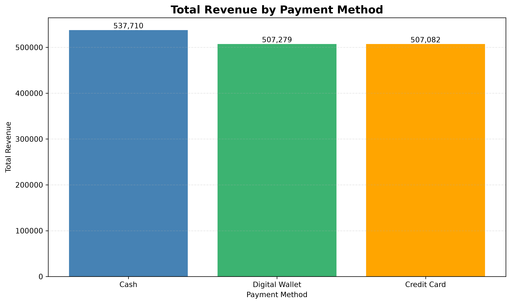
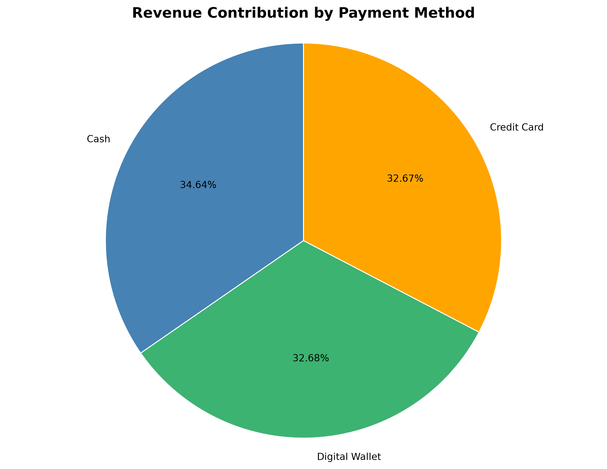
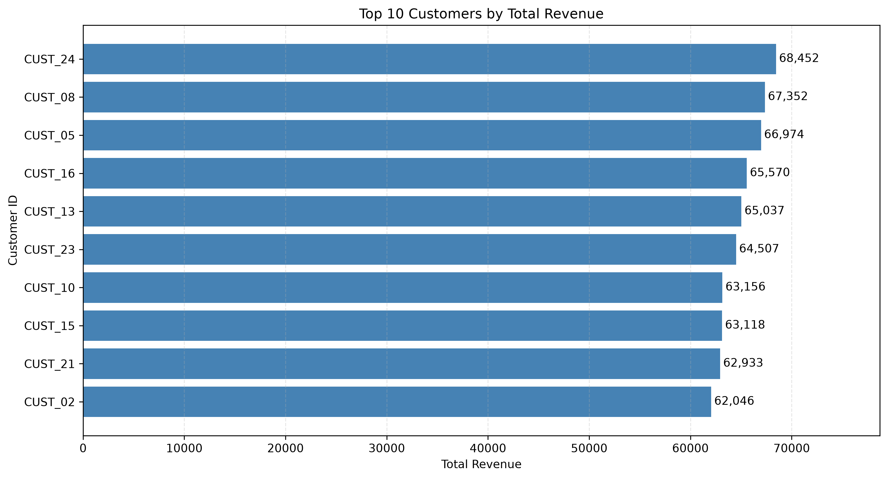
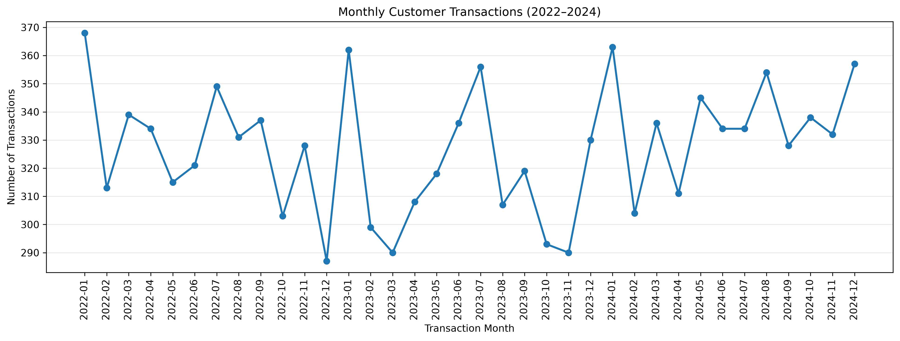
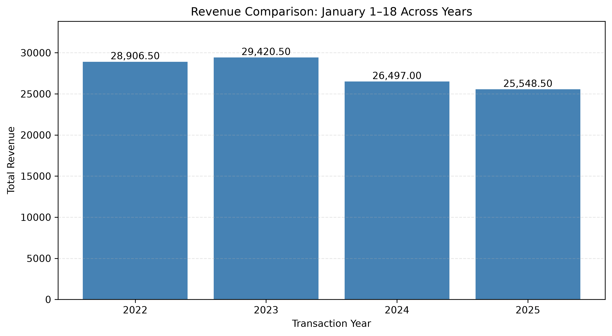

# E-commerce Sales Analysis Using Python

## Project Overview

This project analyzes e-commerce transaction data to identify sales trends, customer spending patterns, product category performance, and payment method contributions.

The objective is to transform transactional data into meaningful business insights that can support data-driven decision-making.

## Project Objectives

- Analyze sales and revenue performance.
- Examine product category performance.
- Compare revenue contributions across payment methods.
- Investigate customer spending and revenue concentration.
- Identify monthly transaction patterns.
- Develop actionable business recommendations.

## Tools and Technologies

- Python
- Jupyter Notebook
- pandas
- Matplotlib
- Exploratory Data Analysis (EDA)
- Descriptive Statistics

## Key Findings

### Payment Method Performance

- Cash contributed 34.64% of revenue.
- Digital wallets contributed 32.68%.
- Credit cards contributed 32.67%.

Revenue was relatively evenly distributed across payment methods.

### Product Category Performance

Comparing January 1–18, 2024, with the corresponding period in 2025:

- Computers and Electric Accessories recorded 57.02% revenue growth.
- Electric Household Essentials experienced a 27.60% revenue decline.

### Customer Revenue Analysis

- The top five recorded customer IDs contributed 21.48% of total revenue.
- The top ten contributed 41.82%.
- Customer revenue had a coefficient of variation of 4.73%.

### Data Limitations

The dataset contains only 25 unique customer IDs, associated with unusually frequent transactions. Customer loyalty and retention conclusions therefore require additional validation.

January 2025 contains only 18 days of transaction records, so comparisons must use equivalent reporting periods.

## Business Recommendations

1. Investigate declining product categories to identify potential performance issues.
2. Evaluate opportunities to strengthen growing product categories.
3. Maintain support for multiple payment methods.
4. Validate customer identifiers before developing retention strategies.
5. Monitor revenue concentration among recorded customer IDs.
6. Develop recurring dashboards to track sales performance.

## Project Files

- `Ecommerce_Sales_Analysis.ipynb` — Python analysis notebook.
- `data/` — Project dataset.
- `images/` — Saved analysis visualizations.

## Data Visualizations

The following charts highlight key findings from the e-commerce sales analysis.

### Revenue Contribution by Category

### Revenue by Payment Method

### Payment Method Revenue Share

### Top 10 Customers by Revenue

### Monthly Customer Transactions

### January Revenue Comparison

## Conclusion

This project demonstrates practical skills in Python programming, data analysis, descriptive statistics, data visualization, and business insight generation.

The findings are exploratory and should not be interpreted as proof of causation.
